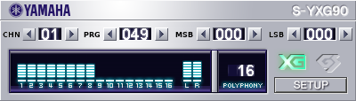
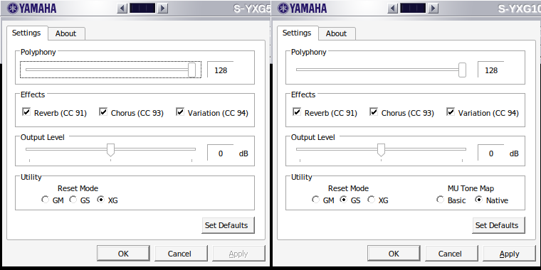

# SXG-Create

Converts the ROM sets of Yamaha MU-series tone generators (MU50 to MU1000, and the MU2000) into tables and wave data for the **S-YXG50** soft synthesizer (`syxg50.dll`), and patches the DLL so that it can play them as close to the original module as the S-YXG50 engine allows.

## Table of contents

- [Patcher](#patcher)
- [Supported models and ROM sets](#supported-models-and-rom-sets)
- [Using the converted plugins](#using-the-converted-plugins)
- [Panel controls](#panel-controls)
- [Setup page](#setup-page)
- [Polyphony up to 256](#polyphony-up-to-256)
- [MU Basic voice maps](#mu-basic-voice-maps)
- [S-YXG2006LE](#s-yxg2006le)
- [More documentation](#more-documentation)
- [Credits and license](#credits-and-license)

---

## Patcher

The easiest way: download the patcher for your system from the newest **Autobuild** release (marked Latest, on top of the Releases page; older autobuilds are kept for comparison). It is a single program file; nothing is installed.

| System | File | Start |
|---|---|---|
| Windows | `SXG-Create-NF-Patcher-rN-windows.exe` | double-click |
| Linux | `SXG-Create-NF-Patcher-rN-linux.tar.gz` | extract, then run `SXG-Create-NF-Patcher` |
| macOS (M1 and newer) | `SXG-Create-NF-Patcher-rN-macos-applesilicon.zip` | extract, then open `SXG-Create-NF-Patcher.app` |
| macOS (Intel) | `SXG-Create-NF-Patcher-rN-macos-intel.zip` | extract, then open `SXG-Create-NF-Patcher.app` |

1. Put the patcher in a folder together with your MU ROM files, and/or the three files of Yamaha's **S-YXG2006LE** (`SGP2.OLD` or `SGP2.DLL`, also one patched by SGP2VSTi 1.0.2.22 such as `S-YXG2006LE.DLL`; `sxgbnw6l.tbl`, `sxgdat6l.tbl`). Subfolders are fine, e.g. one per model; file names don't matter (detection by CRC32). **`syxg50.dll` is no longer needed:** the patcher carries ready-patched plugin templates (see [Plugin templates](docs/templates.md)).
2. Start the patcher. It lists the S-YXG2006LE first (one line, when all three files are there), then every complete ROM set it found, starting with the MU50. If it finds no ROMs, it asks for the folder; **Choose folder…** points it to another place at any time.
3. Click **Patch**. All listed models are converted, several at the same time on a multi-core CPU, and the S-YXG2006LE is patched in the same run. The plugins end up in the folder **`Plugins`** next to the patcher: one DLL per model (`syxgmu50.dll`, `syxg80.dll` ... `syxg1000.dll`, `syxg2000.dll`) with the tables inside (`--embed`), no ini or table files needed, and `syxg2006le.dll` with its two tables inside (see [S-YXG2006LE](#s-yxg2006le) for its parameters). **Open folder** shows them.

- **Language:** the system language if available, else English; the menu at the top right switches between 29 languages, each shown in its own name and sorted alphabetically by the Latin spelling of that name: العربية, Bahasa Indonesia, বাংলা, Čeština, Dansk, Deutsch, Ελληνικά, English, Español, فارسی, Français, 한국어, हिन्दी, Italiano, עברית, Magyar, Nederlands, 日本語, Polski, Português, Română, Русский, Српски, Svenska, ไทย, Tiếng Việt, Türkçe, Українська, 中文.
- **Show details** shows the converter's log (the same text the Python script prints).
- **Update** (issue #72): a moment after it has started, the patcher asks GitHub for the number of the newest Autobuild release (the redirect of the Latest page; no login, no API, nothing else is sent). If it is newer than the running one, **A newer version (rN) is available!** appears under the buttons. **Update** (left of **Show details**) then asks once (OK / Cancel), downloads the file for your system with a progress bar, checks its size and the SHA-256 that GitHub shows, lets the new version pass its own `--selftest`, and starts it; the old window closes. The new version goes into the folder of the patcher (that is where the ROMs are searched); if that folder is read-only, into your Downloads folder.
  - **Windows:** the new `SXG-Create-NF-Patcher-rN-windows.exe` is placed next to the old one, and the new patcher deletes the old one as soon as it has ended. Only a file with the official name `SXG-Create-NF-Patcher-rN-windows.exe` is deleted; a renamed copy stays.
  - **Linux:** the program file is replaced. **macOS:** the app is replaced; the old one is deleted by the new one after it has started.
  - **Not for everyone:** start the patcher with `--no-update-check` (or set `SXG_NO_UPDATE_CHECK=1`) and it does not look at the start; **Update** still checks when you click it. A patcher run from source (`python patcher.py`) does not update itself. The patcher files are not signed (see below), so the update is as trustworthy as downloading the file yourself.
- **Not signed:** the patcher files carry no code signature, so the system warns on the first start:
  - **Windows:** SmartScreen shows "Windows protected your PC". Click **More info**, then **Run anyway**.
  - **macOS:** Gatekeeper says the app "cannot be opened because the developer cannot be verified" (or that it is damaged). Right-click (Control-click) the app, choose **Open**, then **Open** again; on macOS 15 and newer: try to open it once, then go to **System Settings → Privacy & Security** and click **Open Anyway**. Alternatively, in Terminal: `xattr -dr com.apple.quarantine SXG-Create-NF-Patcher.app`.
  - **Linux:** if the file is not executable after extracting: `chmod +x SXG-Create-NF-Patcher`. The window needs a desktop session (X11 or Wayland with XWayland).

---

## Supported models and ROM sets

| Model | Program ROM(s) | Wave ROMs | Table layout |
|---|---|---|---|
| MU50 (xr174c0 v1.05) | `xr174c0.ic7` | `xq057c0.ic18`, `xq058c0.ic19` | classic |
| MU80 (xq556a0 v1.04) | `yamaha_mu80.bin` / `xq556a0.ic8` | `xq012b0-822.bin`, `xq013b0-823.bin`, `xq089b0-824.bin`, `xq090b0-825.bin` | classic |
| MU90 (xs519d0 v1.01) | `xs519d0.ic9` | `xs518a0.ic22`, `xs743a0.ic23` | classic |
| MU90B (xt040c0 v1.01) | `xt040c0.ic9` | `xs518a0.ic22`, `xs743a0.ic23` | classic |
| MU100 (xu50720 v1.11) | `xu50720.ic11` | `xs518b0.ic34`, `xs743b0.ic35`, `xt445a0-828.ic36`, `xt461a0-829.ic37`, `xt462a0.ic39`, `xt463a0.ic38` | big |
| MU128 (v2.00) | `mu128-v2.00-h.bin`, `mu128-v2.00-l.bin` | `xv364a0.ic53`, `xv365a0.ic54`, `xv366a0.ic57`, `xv376a0.ic58` | big |
| MU1000 (v2.01) | `mu1000-v2.01-h.bin`, `mu1000-v2.01-l.bin` | `xv364a0.ic49`, `xv365a0.ic50`, `xw848a0.ic53`, `xw849a0.ic54` | big |
| MU2000 (v2.01) | `mu2000-v2.01-h.bin`, `mu2000-v2.01-l.bin`, or `mu2000_flash.bin` (S-MU2000 ROM folder) | `xv364a0.ic49`, `xv365a0.ic50`, `xw848a0.ic53`, `xw849a0.ic54` (the MU1000's; in the S-MU2000 folder under `dump/`) | big |

File names are only examples; the files are recognised by their CRC32.

File names are only examples; the files are recognised by their CRC32. MU2000 is only converted when no MU1000 set is there (same sound data, see [Models, output files and table layouts](docs/models-and-output.md)).

| S-YXG2006LE | `SGP2.OLD` or `SGP2.DLL` (CRC32 `A62F256A`, `68FD2825` or `F5037F5F`), `sxgbnw6l.tbl` | `sxgdat6l.tbl` | original, not converted |

The S-YXG50's own tables and `Vampire.dll` are recognised as well, but they are not a conversion source.

---

## Using the converted plugins

- **Host:** syxg50.dll is a 32-bit VST2 instrument. Any VST2 host works; to use it as a system MIDI device (e.g. for DOSBox or Windows games), load it through a VSTi MIDI driver.
- **Which model:** MU50 sounds like the DB50XG, SW60XG and the S-YXG50 itself, which is what most players of 1990s games heard. MU90/MU100 are good all-rounders with better samples and similar balance (MU100 = SW1000XG sound set). MU1000/MU128 have the best samples and the most voices, but are larger and partly revoiced; the "MU Tone Map" switch (Basic) in Setup gives the MU90-compatible voice set for older material.
- **GS:** GS songs play through Yamaha's GS mode, an approximation of the Roland sound set. MT-32 music needs an MT-32 emulator.
- **Installing:** copy the finished DLL (from the `Plugins` folder) to where your host looks for VST2 plugins. The tables are inside the DLL; no ini or table files are needed. Without the patcher, the Python script writes the same plugins to `output` ([Python script](docs/python-script.md)).
- **Instrument lists:** players that substitute "missing" programs from an instrument list (e.g. Falcosoft MIDI Player with `S-YXG50_XG-GS.ins`) replace the MU-only drum kits with the Standard Kit. Select an instrument definition for the converted model (e.g. `Yamaha_MU1000_XG.ins`).

---

## Panel controls

All MU plugins have a control row under the title strip (panel 400 x 114):

- **CHN ◀ 01 ▶** selects the MIDI channel (01-16) for the three controls on its right.
- **PRG ◀ 001 ▶** steps the program of that channel (001-128). On a drum part it steps through the kits the engine knows.
- **MSB ◀ 000 ▶** and **LSB ◀ 000 ▶** step the channel's bank select; a step sends the bank select and a program change, so the new bank sounds at once. A bank value the engine ignores in its current mode shows **---**.
- **Colours:** the PRG digits of a **drum part** are dimmed grey; **red** PRG digits mean that the channel's bank / program combination has no instrument and stays silent.
- **Operation:** click for a single step, hold to repeat, or use the mouse wheel over a control. Each plugin instance has its own row. Nothing of it is saved.
- **Preview note:** hold the left mouse button in the **POLYPHONY** field to play a note on the selected channel; the mouse wheel there changes the pitch (default C4).

Details: [Panel controls](docs/gui.md#panel-controls-channel-program-bank).

## Setup page

The **Setup** button of the panel opens the Settings page:

- **Polyphony:** one slider, 8-256 (default 256); see below.
- **Effects:** switches **Reverb (CC 91)**, **Chorus (CC 93)**, **Variation (CC 94)**. Unticked, the block is off.
- **Output Level:** -12 dB to +12 dB in 0.5 dB steps, 0 dB (default) in the centre.
- **Send Reset:** buttons **MT-32**, **GM**, **GS**, **XG**, **GM2** send that reset once to the synth. Nothing is sent when the plugin loads and nothing is saved. Resets from MIDI files always pass unchanged. On MU100 / MU128 / MU1000 the buttons sit in the **Utility** box.
- **MU Tone Map** (MU100 / MU128 / MU1000): **Basic** or **Native** (default); takes effect with Apply / OK.
- **Monitor panel:** the S-YXG50's monitor panel (part levels, polyphony, load readouts) replaces the normal panel with `DebugPanel=1` in the ini.

Details: [Setup page](docs/gui.md#setup-page).

## Polyphony up to 256

The S-YXG50 engine has 128 voices. With **Polyphony** above 128 on the Setup page (default 256) the plugin runs a second engine for the additional voices. It sleeps as long as a song needs 128 voices or fewer, and then costs next to nothing. Details and limits: [Polyphony up to 256](docs/gui.md#polyphony-up-to-256).

## MU Basic voice maps

The MU100, MU128 and MU1000 have two voice maps: **MU Native** (revoiced, default) and **MU Basic** (MU90-compatible). Both are in the converted table; switch with **MU Tone Map** on the Setup page. The change applies to the next note on every part and is saved with the host's plugin state (the plugin writes no files). Details: [MU Basic voice maps](docs/gui.md#mu-basic-voice-maps).

---

## S-YXG2006LE

Yamaha's own engine; its tables are used unconverted. The patcher removes the host lock and adds an editor like the panel of the MU plugins (including SETUP), and the settings appear as host parameters: **Polyphony** 8-256 (default 256), **Reverb (CC 91)** and **Chorus (CC 93)** On / Off, **Master Volume** -12 ... +12 dB, **Master Tune**, **Transpose** and **Send Reset** (MT-32 / GM / GS / XGLite / GM2). You need `SGP2.OLD` or `SGP2.DLL` (CRC32 `A62F256A`, `68FD2825` or `F5037F5F`), `sxgbnw6l.tbl` and `sxgdat6l.tbl`; the patcher writes `syxg2006le.dll` with the tables inside. Details: [S-YXG2006LE (details)](docs/s-yxg2006le.md).

---

## More documentation

Technical documentation is in [`docs`](docs):

| Document | Content |
|---|---|
| [Changes compared to the original SXG-Create](docs/changes.md) | Complete list of what this fork adds |
| [Python script and command line](docs/python-script.md) | `main.py`, parameters, examples |
| [Models, output files and table layouts](docs/models-and-output.md) | Table layouts, file sizes, MU2000 |
| [DLL patching](docs/dll-patching.md) | Patch sites, file names, ini, embedded tables |
| [Plugin templates](docs/templates.md) | How the patcher gets its ready-patched plugins |
| [GUI reference](docs/gui.md) | Full description of panel, Setup page, polyphony, voice maps |
| [S-YXG2006LE (details)](docs/s-yxg2006le.md) | Patches, parameters and editor |
| [What the conversion does](docs/conversion.md) | Conversion details per model |
| [Verification](docs/verification.md) | Measurements against the S-MU2000 and S-YXG50 |
| [Known limitations](docs/limitations.md) | Limits and rejected changes |
| [Development notes](docs/development.md) | Folder layout, autobuild, patcher development, tools |

---

## Credits and license

- **Soundshock** – original [SXG-Create](https://github.com/Soundshock/SXG-Create)
- **tarboh** – [S-MU2000](https://github.com/tarboh/S-MU2000), the reference for the sound comparisons
- **TaleTN** – [MUTable](https://github.com/TaleTN/MUTable), MU series data table documentation (MU50 ext drum voice table, MU2000 scaling tables)
- **VEG** (Evgeny Vrublevsky) – [S-YXG50](https://veg.by/en/projects/syxg50/) (`syxg50.dll`, included in this repository with the author's permission)
- **Yamaha** – MU series tone generators and the S-YXG50 sound engine

DPCM delta table, DPCM limits table, and delta format decoding code based on MAME, copyright (c) MAME contributors, and related contributions by TaleTN, tarboh, and hockinsk under the BSD-3 license.

license: BSD-3-Clause

copyright-holders: Olivier Galibert
